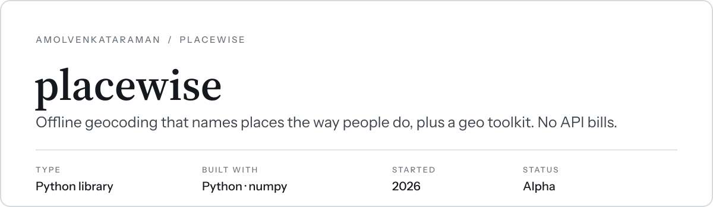
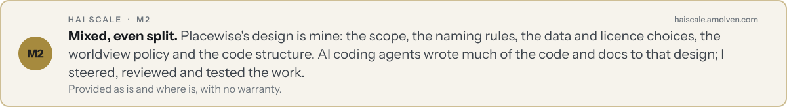

<!-- header:start -->
<div align="center">




[](https://github.com/amolvenkataraman/placewise/blob/master/LICENSE)
[](https://github.com/amolvenkataraman/placewise-data)

[Why](#why) · [Quick start](#quick-start) · [What it does](#what-it-does) · [Data](#data) · [Status](#status)

</div>

<a href="https://haiscale.amolven.com/M2/"></a>

<sub>Not an official source of place names or boundaries. Full terms: [DISCLAIMER.md](https://github.com/amolvenkataraman/placewise/blob/master/DISCLAIMER.md)</sub>
<!-- header:end -->

**TL;DR:** the free way to turn a GPS point into a place name is "find the nearest big city within
some radius", which is how a photo taken on the Canadian side of Niagara Falls ends up in Buffalo,
New York, and a boat on Lake Ontario ends up in Rochester. The good way is Google's Geocoding API,
which is lovely until you look at the bill: roughly **$5 per 1,000 points**, so naming one 100k-photo
library costs about $500, a location history of a few hundred thousand points about $1,000, and you
pay again every time the data changes, while every place you have ever been goes to Google.
placewise is the third option: the answer a person would give, computed on your own machine, for free.

## Status

> [!WARNING]
> **Early alpha.** It is usable, but expect rough edges and breaking changes.
>
> **Works today:** reverse lookup on the world data (countries, states and provinces, 172k cities,
> airports, time zones by polygon), with full depth for the **US, Canada and India** (municipality,
> county or district, metro area, ZIP / FSA / PIN code, neighbourhoods), first naming rules ("Las
> Vegas" for the Strip, Mississauga for Pearson, Gurugram in Haryana), curated regions (GTA, GTHA,
> Bay Area, Delhi NCR ...), water ("Over Lake Ontario"), US and Canadian parks ("within Yosemite
> National Park"), admin areas for 11 more countries (Sri Lanka, Nepal, Bangladesh, Thailand,
> Vietnam, Mexico, South Africa, Kenya, Egypt, Türkiye, UAE), worldviews (default de facto; `IN`
> answers India for every area India claims), forward search (`placewise.find("Yosemite")`, codes,
> typos, context such as `country="USA"`; `docs/search.md`), location-string parsing, the geo toolkit, track
> files, privacy tools, a local service and a self-hosted web server.
>
> **Doesn't work yet:** notable places and
> universities, India state/district/city outlines (India uses PIN-code areas for now), UK,
> Europe, Australia and most other countries beyond the world baseline, elevation, roads and
> trails, the `reverse`/`explain` CLI commands, Docker. Expect slow first lookups (indexes
> are built on first use) and roughly 25–50k points/s after that.
>
> **Install:** `pip install --pre placewise` (alpha), then `placewise data install world` (and
> `usa`, `can`, `ind`, `world-water`, `usa-parks` ... as needed; `placewise data list` shows them all).

## Why

Most offline geocoders (and many apps built on GeoNames) label a point with the nearest place above
some population inside a radius. It's simple and it's wrong in ways people notice immediately:

| Point | Nearest-city radius answer | placewise | Why the radius gets it wrong |
|---|---|---|---|
| Fort Erie, Ontario | Buffalo, New York (country: Canada) | Fort Erie, Ontario, Canada | City and country come from opposite sides of the border |
| The Las Vegas Strip | Paradise | Las Vegas (in Paradise CDP) | Legally correct, but nobody says Paradise |
| Emeryville, California | Oakland | Emeryville | A small incorporated city next to a big one |
| Toronto Pearson airport | Toronto | at YYZ, Mississauga | No airport awareness; the airport isn't in Toronto |
| Gurugram, Haryana | Delhi, state Delhi | Gurugram, Haryana · Delhi NCR | The nearest place is across a state line |
| A boat on Lake Ontario | Rochester, 50 km away | Over Lake Ontario | Water has no cities, so the radius reaches for one |
| Mid-Atlantic, 50 N 30 W | a town 1,176 km away | Over the North Atlantic Ocean | Same, but worse |
| Yosemite Valley | Yosemite Valley | Yosemite Valley · Yosemite National Park | No park layer |

And the alternatives:

| Option | Cost | Catch |
|---|---|---|
| Google Geocoding API | ~$5 per 1,000 requests after a small free allowance | Every coordinate goes to Google; terms restrict storing and reusing results |
| Mapbox, HERE, OpenCage, LocationIQ | Cheaper than Google, still metered | Coordinates leave your machine; storage terms vary; rate limits for bulk history |
| Self-hosted Nominatim / Photon / Pelias | Free | ~1 TB of disk and 64 GB+ of RAM for the planet, hours to import, ops work; "city" follows OSM tagging |
| reverse_geocoder and similar | Free, tiny | The same nearest-city radius as above |
| **placewise** | Free; code under 1 MB, data packs of tens of MB per region | No street addresses or house numbers (not a goal); English names only for now |

placewise works from real boundaries (municipalities, counties, census areas, postal areas, water
bodies, parks) built from open government and open-data sources, and only falls back to "nearest
city" where nothing better exists. Every answer says which dataset and rule produced it, and you
can override any of it.

It is built for everyone from someone who just wants their Yosemite photos labelled to GIS
professionals: plain words on the simple path, precise terms (EPSG codes, ellipsoids, error
bounds) one step away.

## Quick start

```python
import placewise

r = placewise.lookup(43.6426, -79.3871)       # downloads the world pack on first use
r.label                                       # "Toronto, Ontario, Canada"
r.admin1.codes, r.tz, r.airport               # ISO codes, "America/Toronto", Nearby(YTZ, 1.8 km)
placewise.Geocoder().lookup_many(lats, lons)  # vectorised, tens of thousands of points/s

r = placewise.lookup(36.1147, -115.1728)      # with the usa pack installed: the Las Vegas Strip
r.locality.name, r.sublocality.name           # "Las Vegas", "Paradise" (the census place)
r.postal.name, r.admin2.name                  # "89109", "Clark County"

placewise.lookup(35.9208, 74.3089, worldview="IN").label   # "Gilgit, Ladakh, India" (docs/worldviews.md)

placewise.find("Yosemite")[0]                 # Entity: place, a point inside it, bbox, radius, context
placewise.find("Paris", country="USA")[0]     # Paris, Texas; also state=, near=, within=, kinds=
placewise.find("YYZ")[0].place.name           # "Toronto" (the city it serves); kinds="airport" for the airport
placewise.get("census:0646870")               # by id; placewise.suggest("Mississ") for type-ahead

from placewise.text import parse_location
parse_location("US-CA-Menlo Park; Remote - US and Canada")  # structured places, offline
```

`placewise find "Lake Tahoe"` prints the same from the command line (`--json` for Entities).
The same lookups run as a local service or a self-hosted web server (`placewise serve`, see
`docs/self-hosting.md`), with `placewise.Client` offering the identical interface.

## What it does

- **Forward search** (`docs/search.md`): names, aliases, codes (IATA, postal, ISO, Wikidata),
  typos and prefixes to places with a point inside, box, radius, outline and context; context
  from the text ("Paris, TX") or arguments (country, state, near, bbox, within, kinds).
- **Reverse lookup** (`docs/naming.md`): three names per point (sublocality, locality, city),
  county or district, metro and curated regions, postal area, time zone (by polygon), nearest
  airport, water body (`docs/water.md`), parks (`docs/parks.md`), with the source of every field.
- **Worldviews** (`docs/worldviews.md`): de facto by default; per-country views (e.g. `IN`, `CN`)
  and an operator lock for services that must follow one country's map.
- **Overrides** (`docs/overrides.md`): rename, relabel, add or hide places, from the repo, your app
  or a local file.
- **Location search** (`docs/text-parsing.md`): parse messy place strings ("Greater Toronto Area",
  "Remote - EMEA", "Bengaluru (BLR)") into structured places, with filters that explain themselves.
- **Countries and groups** (`docs/world.md`): `placewise.world` for countries, subdivisions, 72
  country groups with dated memberships (EU, Schengen, NATO, EMEA ...) and country profiles.

## Geo toolkit (`placewise.geo`), no data needed

```python
from datetime import date
from placewise import geo

geo.distance(43.6532, -79.3832, 45.5019, -73.5674)                       # km, haversine
geo.distance(43.6532, -79.3832, 45.5019, -73.5674, method="geodesic")    # Karney, WGS84
geo.initial_bearing(43.65, -79.38, 45.50, -73.57)                        # degrees
geo.destination(43.65, -79.38, bearing=45, distance_km=10)
geo.parse("43°38′33.2″N 79°23′13.4″W")                                   # also Google/Apple/OSM URLs
geo.to_utm(43.6426, -79.3871)                                            # also UPS, MGRS, ECEF, ENU
geo.plus_code_encode(43.6426, -79.3871)
geo.sun_times(43.6426, -79.3871, date(2026, 6, 21))
```

Also: geohash, map tiles and quadkeys, encoded polylines, line simplification, nearest point on a
line, spherical areas, antimeridian-aware bounding boxes, a two-stage polygon index for detailed
GeoJSON or shapefile boundaries, and a registry of every coordinate system used with its EPSG code
(`placewise.constants.crs`).

## Tracks (`placewise.tracks`, `placewise.io`)

```python
from placewise.tracks import Track

track = Track.read("ride.fit")        # GPX, FIT, TCX, KML/KMZ, GeoJSON, NMEA or CSV, detected from content
track = track.clean()                 # sort, dedupe, drop invalid fixes, remove spikes, split gaps
track.stats()                         # distance, moving time, elevation gain, speeds, heart rate
track.position_at(photo_times)        # where you were at each time (great-circle interpolation)
track.stays()                         # places you stopped, with gap bridging
```

Readers and writers need no dependencies (FIT is decoded from the public spec). Operations include
Kalman smoothing, thinning, resampling, splits and best efforts, camera clock-offset estimation for
photo geotagging, trips, travel modes, flights, time inside an area, border crossings, days per
country, merging recordings from several devices, and route comparison (Hausdorff, Fréchet,
corridor overlap, deviations).

## Privacy (`placewise.privacy`)

```python
from placewise import privacy

key = b"..."                          # at least 16 secret bytes, kept and reused
shared = privacy.apply(track, privacy.preset("public_share"), key)
```

Privacy zones whose cut points don't give away the hidden place, secret-length trimming, keyed grid
snapping, geo-indistinguishable noise, time coarsening, and an audit of what a track reveals. Every
tool documents what it does *not* protect against.

## Data

```
placewise data install world          # download, verify and install a pack
placewise data list                   # installed and available packs (country packs: lookups
                                      # use them once installed)
placewise data update                 # newer versions (never automatic, never deletes)
placewise attribution                 # the installed packs' sources, licences and credits (--all, --short)
```

Everything placewise downloads lives in `~/.placewise/` unless configured otherwise (`--data-dir`,
`PLACEWISE_DATA_DIR` or `data.data_dir` in `placewise.toml`; `placewise data where` prints it).
Packs are memory-mapped and checksummed (format: `docs/pack-format.md`). Data sources are listed in
`src/placewise/sources/`, one JSON file per purpose (boundaries, places, regions, postal codes,
airports ...) giving the sources used in each region, and `ATTRIBUTION.md` is generated from them,
so an app that ships placewise data can link to that one file.

Packs are published as release assets of `amolvenkataraman/placewise-data` (`index.json` plus one
`.tar.xz` per pack); any copy of a release's files works as a mirror (`--index-url`, `data.mirrors`).

## Conventions

- Coordinates are WGS84 degrees, always in `(lat, lon)` order (GeoJSON uses `(lon, lat)`).
- Every function accepts scalars or numpy arrays and broadcasts; scalars in, plain floats out.
- Distances are kilometres unless a name ends in `_m`.
- English names only; standard coordinate systems only (no obfuscated ones like GCJ-02).

## Licence

The code is licensed under the [Apache License 2.0](LICENSE) (see also [NOTICE](NOTICE)). The data
packs keep their sources' licences (`ATTRIBUTION.md`); placewise's own curated datasets, in the
placewise-data repository, are CC BY 4.0.

## Disclaimer

placewise and its data packs are provided "as is" and "where is", with no warranty of any kind and
no legal liability for their use. Names, boundaries and other data may be wrong or out of date and
are not an official determination of any territory's status. See [DISCLAIMER.md](DISCLAIMER.md).

## Development

```
uv sync                 # creates .venv with the dev tools
uv run pytest           # tests
uv run ruff check .     # lint
uv run ruff format .    # format
```

Requires Python 3.10+. The runtime depends on numpy only; `pip install placewise[geodesic]` adds
GeographicLib for ellipsoidal distances. `packbuild/` (not shipped) turns public datasets into packs.
